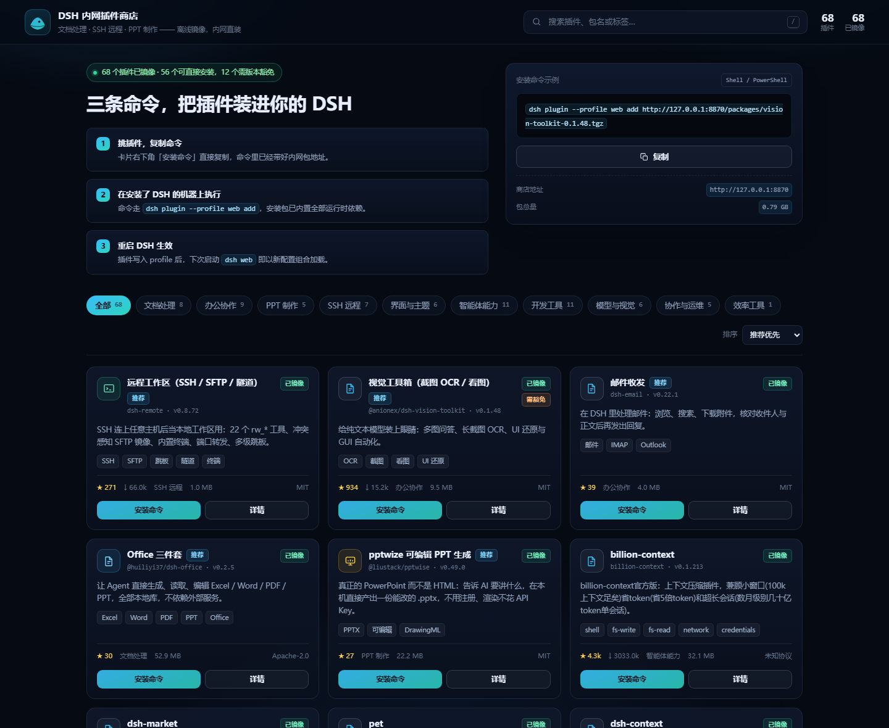
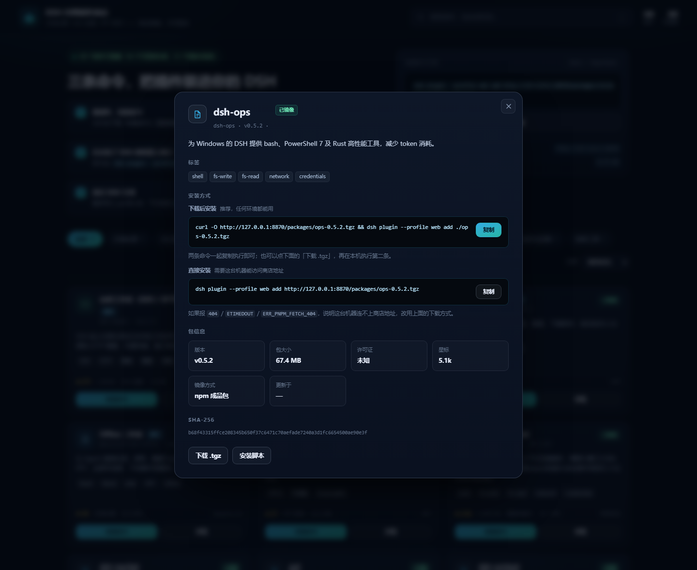
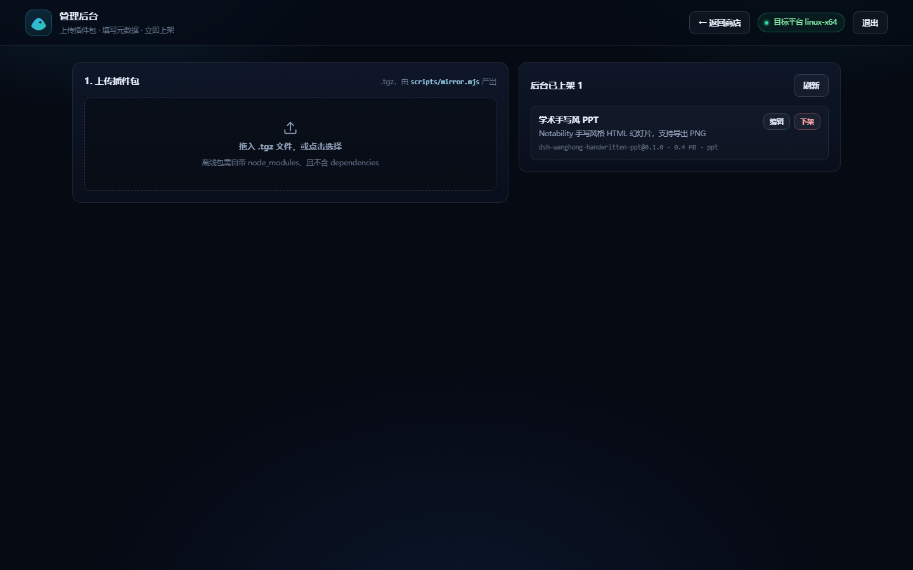

# DSH 内网插件商店

给内网开发人员用的 DSH 插件商店：网页上架 + 离线安装包 + 零依赖 Node 服务 + 后台管理。

部署目标：**Linux x64 服务器（无外网）**。用户打开网页 → 下载 `.tgz` → 一条命令装进自己的 DSH。

当前上架 5 类共 30 个插件：**文档处理**（8）、**SSH 远程**（5）、**PPT 制作**（5）、**办公协作**（12，IM 接入 / 邮件 / 通知 / 笔记 / 汇报）、**效率工具**（1）。







## 它解决什么问题

内网机器连不上 GitHub，也连不上公共 npm。而 DSH 安装插件用的是 pnpm，`pnpm add` 会顺着 `dependencies` 去 registry 拉包——离线环境下必然失败。

所以镜像时做了两件关键的事：

1. **把运行时依赖物化进包内**：每个 `.tgz` 里已经带上 `node_modules`。
2. **从包内 `package.json` 移除 `dependencies`**：pnpm 安装时没有任何东西需要联网解析。

配合 DSH profile 默认的 `autoInstallPeers: false`，`peerDependencies` 也不会触发补装。已实测：安装时**零 registry 请求**。

## 快速开始（Linux 服务器）

目标环境：**CentOS 7 / glibc 2.17 / x86_64**。

**服务器不需要预装 Node.js**——交付包里自带一份 **glibc-2.17 构建**的 Node 22（`runtime/node/`，官方 22 需要 glibc 2.28，这里用的是 unofficial glibc-217 构建，实测最高只要求 `GLIBC_2.17`）。

```bash
tar -xzf dsh-plugin-store-<日期>.tgz
cd dsh-plugin-store
chmod +x start.sh
./start.sh                 # 默认 0.0.0.0:8787
```

`start.sh` 的选路逻辑：系统里有 Node 18+ 就用系统的，没有就用包内的 `runtime/node/bin/node`，启动时会打印实际用的是哪个。

改端口：`PORT=8080 ./start.sh`。

### 用 systemd 常驻

```bash
sudo useradd -r -s /usr/sbin/nologin dshstore
sudo mkdir -p /opt/dsh-plugin-store
sudo cp -r ./* /opt/dsh-plugin-store/
sudo chown -R dshstore:dshstore /opt/dsh-plugin-store
sudo cp deploy/dsh-store.service /etc/systemd/system/
sudo systemctl daemon-reload
sudo systemctl enable --now dsh-store
sudo systemctl status dsh-store
```

放通端口：

```bash
sudo firewall-cmd --permanent --add-port=8787/tcp && sudo firewall-cmd --reload   # firewalld
sudo ufw allow 8787/tcp                                                          # ufw
```

商店地址就是安装命令里的地址，比如 `http://10.0.8.21:8787`。

## 用户怎么装

页面上每个插件给出两条路，都是复制即用：

**直接安装**（能访问商店地址时最省事）

```bash
dsh plugin --profile web add http://10.0.8.21:8787/packages/remote-workspace-0.8.72.tgz
```

**下载后安装**（纯内网、或商店地址不通时）

```bash
# 先在页面点「下载 .tgz」，然后 cd 到下载目录
dsh plugin --profile web add ./remote-workspace-0.8.72.tgz
```

装完 **重启 DSH**（`dsh web`）生效——DSH 在启动时按 profile 组合插件树，不会热加载。

卸载：`dsh plugin --profile web remove <包名>`。

## 管理后台

浏览器打开 `http://<商店地址>/admin`。

令牌在服务启动时打印在控制台，完整值在服务器 `data/admin-token.txt`（也可用 `DSH_STORE_ADMIN_TOKEN` 环境变量固定）。

进入后：

1. **拖入 `.tgz`** —— 服务端立刻校验：是不是 gzip、有没有 `package/package.json`、`dsh.bundle.patch` 声明的补丁文件在不在、有没有残留 `dependencies`（有就直接拒绝，因为内网装不了）、有没有平台不对的原生模块。
2. **填写展示信息** —— 标题、一句话说明、分类、标签、能力点、是否推荐、是否需要运行期预热。
3. **发布上架** —— 立刻出现在商店首页，无需重启、无需重跑构建。
4. 之后可以**编辑**元数据或**下架**（同时删除服务器上的包文件）。

后台数据落在 `data/admin/`，与随工程分发的基础目录合并展示。

### 后台 API

| 方法 | 路径 | 说明 |
| --- | --- | --- |
| POST | `/api/admin/upload` | body 为 tgz 原始字节，返回校验结果与 `uploadId` |
| POST | `/api/admin/plugins` | 用 `uploadId` + 元数据发布 |
| PATCH | `/api/admin/plugins/<id>` | 改元数据 |
| DELETE | `/api/admin/plugins/<id>` | 下架 |
| GET | `/api/admin/plugins` | 后台列表 |

全部需要请求头 `x-admin-token: <令牌>`（或 `?token=`）。

## 打包插件（在有网机器上做）

```bash
node scripts/mirror.mjs --only remote-workspace   # 只打一个
node scripts/mirror.mjs                           # 全部
node scripts/build-catalog.mjs                    # 刷新网页数据
```

镜像脚本会自动选路：

| 情况 | 策略 |
| --- | --- |
| npm 上已发布且版本不低于仓库 | 拉 npm 成品包（作者构建好的，最稳） |
| 未发布 / 版本落后 | 从 GitHub 源码构建（`install` → `build` → `prune`） |
| 源码构建失败 | 退回 npm 成品包 |

`github.com` 直连不通时会自动退到 `codeload.github.com` 下源码包——国内网络和受限网络里都能用。

### 自己写插件（本地插件）

不想发布到 npm、也没必要建仓库的插件，直接放 `local-plugins/<id>/`，在 `catalog/sources.json` 里用 `local` 指过去即可：

```json
{
  "id": "dlp-recovery",
  "category": "tools",
  "local": "local-plugins/dlp-recovery",
  "packageName": "dsh-dlp-recovery",
  "title": "DLP 加密文件恢复",
  "summary": "..."
}
```

目录结构就是一个标准 npm 包：

```
local-plugins/<id>/
├── package.json          含 dsh.bundle.patch
├── cordis.patch.yml      - insert: [{ id, name }]
├── index.js              插件入口
└── skills/<skill 名>/    skill 型插件放这里（SKILL.md + 资源）
```

镜像脚本会直接打包该目录，不走网络。仓库里自带一个例子 `local-plugins/dlp-recovery/`——它把 `D:\skills\dlp-file-recovery` 的 skill 封成了插件。

### 在 Linux 上出包（WSL）

包里的 `node_modules` 含平台相关二进制，**必须在目标平台上构建**。Windows 上打的包在 Linux 上跑不起来。

有 WSL 的话一条命令搞定：

```bash
wsl bash /mnt/d/dsh_store_plugin/scripts/wsl-build-linux.sh
```

它会：装 node 到 `~/tools` → 装 pnpm → 把工程同步到 ext4 → 全量镜像 → 回传到 `mirror/packages-linux/` 与 `mirror/manifest-linux.json`。

产出的目录按平台区分，`build-catalog.mjs` 会自动优先用 Linux 那一份：

```
mirror/packages-linux/*.tgz      Linux x64 包
mirror/packages/*.tgz            Windows x64 包
mirror/manifest-linux.json       对应清单
```

指定平台：`node scripts/build-catalog.mjs --platform=win32`。

## 平台兼容性（CentOS 7 / glibc 2.17）

服务器和客户端都是 CentOS 7，这里有两处容易踩的地方，都已处理：

| 部位 | 情况 | 处理 |
| --- | --- | --- |
| Node 运行时 | 官方 Node 18+ 要求 glibc ≥ 2.28 | 换成 unofficial **glibc-217** 构建的 Node 22，`readelf` 显示最高只要求 `GLIBC_2.17` |
| 插件的原生模块 | 在 Ubuntu 26 上编译的会要求 glibc 2.38+ | 逐个扫描，绝大多数是 manylinux 预编译件（≤ 2.17） |

扫描结果（`readelf --version-info`）里只有两处超线，已经处理：

- **`sshcrypto.node`（ssh2 的可选加速件，要 2.34）** —— 已从 easyssh / SSH 远程执行 / 远程 Linux 工作区三个包里剔除。ssh2 对它是 `try { require(...) } catch {}`，加载不到会自动退回纯 JS 实现，功能不受影响，只是加解密慢一点。
- **`docling`** —— 它的 `xberg-node` 是 napi-rs 硬依赖（要求 2.28，无纯 JS 回退），在 glibc 2.17 上必然加载失败，**已从商店下架**。

`scripts/wsl-scan-native.sh` 可以随时重扫一遍，确认没有新引入的高版本 glibc 依赖。

## 目录结构

```
start.sh / start.cmd        启动脚本（自动选用包内 Node）
runtime/node/               随包分发的 Node 22 (linux-x64)，服务器无需预装
server.mjs                  商店服务（页面 + API + 包分发）
lib/store.mjs               目录合并、后台存储、上传校验
web/                        前端（原生 HTML/CSS/JS，无构建步骤，无 CDN）
  index.html app.js styles.css      商店
  admin.html admin.js admin.css     管理后台
catalog/sources.json        基础上架清单（人工维护）
local-plugins/              自己写的插件（不走网络，直接打包）
scripts/mirror.mjs          镜像打包器
scripts/build-catalog.mjs   生成前端数据（--offline / --platform）
scripts/wsl-build-linux.sh  WSL 里出 Linux 包
scripts/verify.mjs          包结构校验
scripts/install-matrix.mjs  逐个装进全新 profile 验收
scripts/test-admin.mjs      管理后台端到端自测
scripts/pack-for-intranet.mjs  打成一个可拷贝的 tgz
scripts/lib/tar.mjs         进程内 tar.gz 读写（不依赖外部 tar）
mirror/                     插件包与清单
data/                       后台数据（插件、上传、令牌）
deploy/dsh-store.service    systemd 单元
docs/install.md             给使用者看的安装指南
```

## 校验

```bash
node scripts/verify.mjs                      # 结构校验：JSON 合法、补丁文件在、依赖已物化、sha256 一致
node scripts/test-admin.mjs --port=8801      # 后台端到端（需要服务已启动）
node scripts/install-matrix.mjs --port=8787  # 逐个装进全新 profile，验证 DSH 真的接受
```

## 断网环境的边界

| 动作 | 断网时是否可用 |
| --- | --- |
| 浏览商店、下载 tgz | ✅ 纯本地 |
| `dsh plugin --profile web add <tgz>` | ✅ 已实测零 registry 请求 |
| 后台上传 / 上架 / 下架 | ✅ 纯本地 |
| `node scripts/build-catalog.mjs --offline` | ✅ 不发请求 |
| `node scripts/mirror.mjs` | ❌ 必须联网（进货步骤） |
| 插件**运行** | ⚠️ 大部分纯本地，少数要预热 |

**需要预热的插件**（商店详情页有「需预热」标记）：Docling 首次运行会下载模型权重；MinerU 需要内网可访问的解析服务。其余运行期完全本地。

## 注意

- 包内 `node_modules` 含平台相关产物，**镜像机与目标机必须同平台/架构**。当前包是 linux-x64。
- 后台默认无鉴权以外的保护，只在内网暴露；需要更强控制请前置 Nginx 并限制来源网段。
- 同一时间只允许一个 `mirror.mjs` 进程（`.mirror.lock` 保护），否则清单会互相覆盖。

### 企业透明加密（DLP / Ocular / TSGuard）

在有透明加密的 Windows 机器上打包时有个隐蔽的坑：受信进程写出的文件在磁盘上是密文，外部 `tar.exe` 读到的是 `%TSD-Header-###%` 密文块，打出来的包全是坏的且表面看不出来。

本项目已规避：打包/解包全部在 Node 进程内完成（`scripts/lib/tar.mjs`），不调用外部 `tar`；打完包就地校验包内 `package.json` 与补丁文件。

仍需注意：`mirror/manifest*.json`、`web/data/plugins.json` 这类脚本生成的 JSON 在磁盘上可能是密文，商店服务（Node）读写没问题，但**整目录拷走或提交 git 前要先用 `D:\skills\dlp-file-recovery` 之类工具转成明文**。`*.tgz` 是明文，可直接分发。Linux 上没有这个问题。
